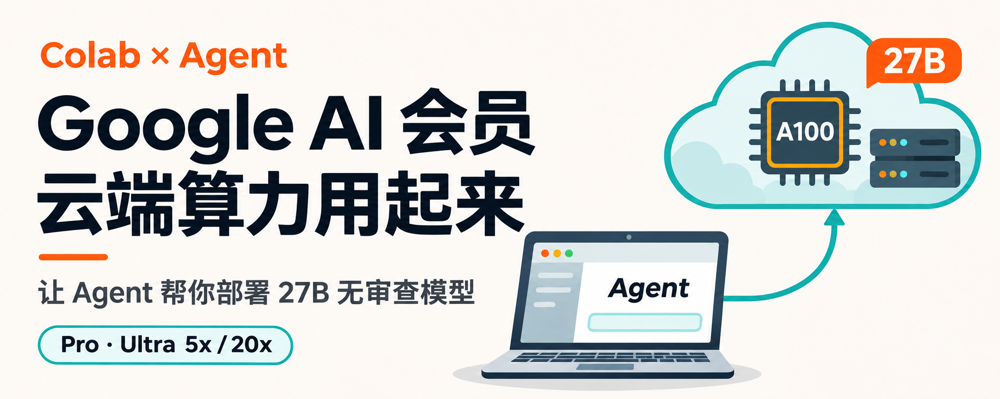

# Colab Agent Deploy



让 Agent 帮你在 Colab 部署模型、接入本机客户端，完成真实聊天和工具调用。你负责账号登录与预算选择，Agent 负责部署、配置、排错和验证。

## 直接交给你的 Agent

把下面这段和你的预算发给 Agent：

```text
请读取 https://github.com/Fonsi479/colab-agent-deploy-skill 的 SKILL.md，按需读取 references/example.md，并按 Skill 完成 Colab 云端模型部署和本机接入。

先检查我已有的 Colab 点数、GPU、模型文件、SSH 和客户端，优先复用。新增算力预算为【金额】元，账号登录、验证码、授权和付款页面交给我完成后继续。

保留我选定的 Agent 后端与现有配置。模型可参考 Skill 中的 27B GGUF 示例。请交付可重复运行的笔记本、可直接打开的聊天入口，并完成真实 API 问答、GUI 问答、演示文件写入和回读，再独立检查文件结果。
```

支持 Skill 的 Agent 可将整个仓库保存为 `colab-agent-deploy` 技能目录。也可以直接读取 [SKILL.md](SKILL.md) 和它引用的文件执行。

## Google AI 会员的 Colab 权益

先用同一 Google 账号打开 [Colab](https://colab.research.google.com/)，检查到账的算力点数。正式付费订阅的账号负责人年满 18 岁时，可在支持地区使用对应权益：Google AI Pro 每月 200 CCUs，Ultra 5x / 20x 对应每月 1,000 / 2,000 CCUs。活动领取的账号先核对实际权益与点数。

权益与地区以 [Google AI 套餐页](https://one.google.com/about/google-ai-plans/)、[Pro 帮助](https://support.google.com/googleone/answer/14534406?hl=en) 和 [Ultra 帮助](https://support.google.com/googleone/answer/16286513?hl=en) 为准。点数消耗取决于实际运行时和占用时长。

## 文件

- [SKILL.md](SKILL.md)：Agent 的部署与验收流程。
- [references/example.md](references/example.md)：A100、27B GGUF、SSH、Pi 和 CC Switch 的实际配置示例。
- [LICENSE](LICENSE)：MIT 开源许可。
